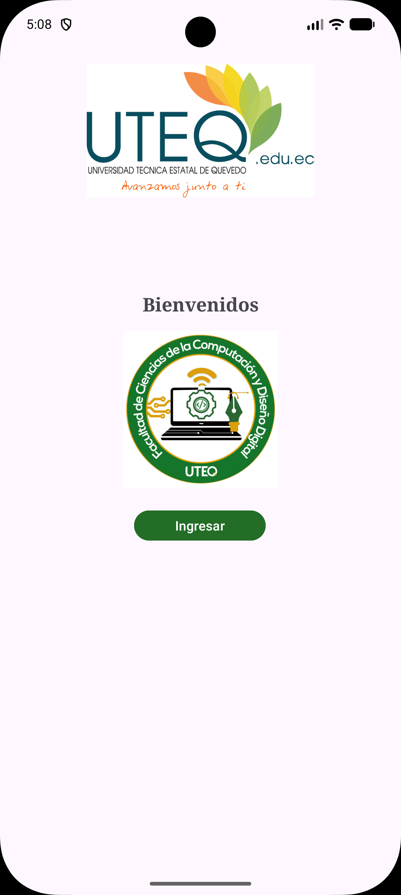

# Práctica 1 - Danna

Esta práctica consiste en el diseño de una aplicación Android que presenta una **pantalla de bienvenida** y una **interfaz de inicio de sesión**. Las pantallas fueron desarrolladas en **XML**, utilizando `ConstraintLayout` para organizar los elementos visuales y componentes de **Material Design** para los campos del formulario.

El objetivo es familiarizarse con la creación de actividades en Android Studio y con el diseño de interfaces para aplicaciones móviles mediante Java y XML.

## Capturas de pantalla

<div align="center">
  
  &nbsp;&nbsp;&nbsp;
  
</div>

## Características

La interfaz está dividida en dos actividades:

- **Pantalla de bienvenida:** presenta el logotipo de la universidad, el logotipo de la facultad, un mensaje de bienvenida y el botón **Ingresar**.
- **Pantalla de inicio de sesión:** muestra el logotipo institucional, un título y dos campos para introducir el correo electrónico y la contraseña.
- **Correo electrónico:** campo de texto configurado para ingresar direcciones de correo.
- **Contraseña:** campo protegido que permite mostrar u ocultar los caracteres mediante el ícono correspondiente.
- **Botón Entrar:** elemento visual que representa la acción de acceso a la aplicación.
- **Diseño:** se emplean componentes de Material Design con bordes de estilo `OutlinedBox` y una combinación de colores verdes y fondo claro.

> **Nota:** Esta práctica se enfoca en el diseño de interfaces. Los botones todavía no tienen navegación programada y no se ha implementado la validación de credenciales ni una base de datos.

## Detalles técnicos

- **Entorno de desarrollo:** Android Studio.
- **Lenguaje de programación:** Java.
- **Diseño de interfaz:** XML.
- **Distribución de elementos:** `ConstraintLayout` para ubicar los componentes mediante restricciones.
- **Componentes utilizados:** `ImageView`, `TextView`, `Button`, `TextInputLayout`, `TextInputEditText` y `MaterialButton`.
- **Actividades:** `MainActivity.java` (bienvenida) e `inicioseccion.java` (inicio de sesión).
- **Archivos de diseño:** `activity_main.xml` y `activity_inicioseccion.xml`.
- **Recursos gráficos:** imágenes institucionales almacenadas en `res/drawable`.
- **Configuración:** `AndroidManifest.xml` para registrar las actividades y Gradle para las dependencias del proyecto.

## Estructura principal del proyecto

```text
app/src/main/
├── java/com/example/practica1danna/
│   ├── MainActivity.java
│   └── inicioseccion.java
├── res/
│   ├── layout/
│   │   ├── activity_main.xml
│   │   └── activity_inicioseccion.xml
│   ├── drawable/
│   └── values/
└── AndroidManifest.xml
```
